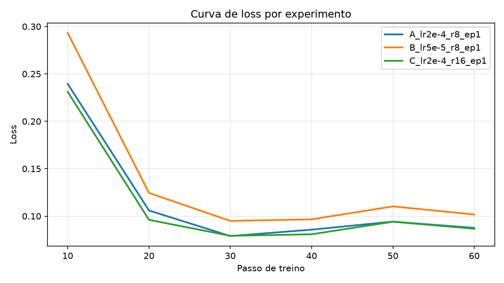

# 🧠 Text-to-SQL com LLM Local (Fine-tuning LoRA em GPU)

**CP2/CP3 – Generative AI for Engineering** · Prof. Francisco Elanio

| Integrante | RM |
|---|---|
| Leonardo Moreira Valério | RM550988 |
| Breno Silva | RM97864 |
| Joel Barros | RM550378 |
| Gustavo Dias | RM550820 |
| Enrico Marquez | RM99325 |

---

## 1. Problema escolhido

**Converter perguntas em linguagem natural em consultas SQL (Text-to-SQL).**

Em engenharia de software, muita gente precisa consultar bancos de dados sem dominar SQL. O modelo recebe o
*schema* da tabela (`CREATE TABLE ...`) e uma pergunta, e devolve **apenas** a consulta SQL.

Escolhemos esse problema porque a resposta é **verificável objetivamente**: dá para comparar o SQL gerado com o
SQL correto e medir a taxa de acerto, antes e depois do treino.

```
Schema:   CREATE TABLE funcionarios (nome VARCHAR, salario INTEGER, departamento VARCHAR)
Pergunta: Qual o salário médio do departamento de Engenharia?
Saída:    SELECT AVG(salario) FROM funcionarios WHERE departamento = 'Engenharia'
```

## 2. LLM escolhida

**[Qwen2.5-0.5B-Instruct](https://huggingface.co/Qwen/Qwen2.5-0.5B-Instruct)** (Alibaba, licença Apache 2.0)

| Critério | Motivo |
|---|---|
| Tamanho (0,5 bilhão de parâmetros) | Treina em minutos e cabe em GPUs com 4 GB+ de VRAM |
| Versão *Instruct* | Já segue instruções no formato de chat |
| Bom em código | A família Qwen2.5 tem bom desempenho em programação, inclusive SQL |
| Roda 100% local | Sem API externa: modelo e dados ficam na máquina |

> Para usar outro modelo (ex.: `Qwen/Qwen2.5-1.5B-Instruct` em GPUs com 8 GB+), basta definir a variável de
> ambiente `MODEL_ID` antes de rodar os scripts.

## 3. Dataset

[`b-mc2/sql-create-context`](https://huggingface.co/datasets/b-mc2/sql-create-context): ~78 mil exemplos de
(pergunta, schema, SQL), derivados do WikiSQL e do Spider.

- **Treino:** 2.000 exemplos (1.000 em GPUs com menos de 6 GB)
- **Teste:** 100 exemplos separados, **nunca vistos no treino** (divisão fixa com `seed=42`)

## 4. Técnica: fine-tuning com LoRA

Em vez de treinar os 494 milhões de parâmetros, usamos **LoRA (Low-Rank Adaptation)**: congelamos o modelo
original e treinamos pequenas matrizes adicionais (cerca de 1–2% dos parâmetros) nas camadas de atenção e MLP.
Isso reduz muito o uso de memória e o tempo de treino, com resultado próximo ao fine-tuning completo.

- A *loss* é calculada **só sobre a resposta SQL**, não sobre o prompt (o modelo aprende a responder, não a repetir a pergunta).
- Precisão escolhida automaticamente: **bf16** em RTX 30xx/40xx/50xx, **fp16** em RTX 20xx/T4 e **fp32** em GTX 16xx
  (essas placas têm problemas conhecidos com fp16). Pode ser forçada com a variável de ambiente `PRECISION`.
- GPUs com menos de 6 GB (ex.: GTX 1650 4 GB) usam um **perfil econômico** automático: batch 2 × 8 acumulações
  (mesmo batch efetivo de 16), *gradient checkpointing* e 1.000 exemplos de treino.
- Tudo roda obrigatoriamente na **GPU**: os scripts abortam se CUDA não estiver disponível.

```
Dataset ──► Tokenização (chat template) ──► Qwen2.5-0.5B + LoRA ──► Treino na GPU
                                                                       │
            Frontend Gradio ◄── Melhor adapter ◄── Avaliação (Exact Match) ◄┘
```

## 5. Parâmetros testados

Cada experimento muda **um** parâmetro em relação ao experimento A (referência), para isolar o efeito:

| Experimento | Learning rate | LoRA rank (r) | Épocas | O que estamos testando |
|---|---|---|---|---|
| A | 2e-4 | 8 | 1 | Referência |
| B | **5e-5** | 8 | 1 | Learning rate menor aprende mais devagar? |
| C | 2e-4 | **16** | 1 | Mais capacidade no adapter ajuda? |
| D | 2e-4 | 8 | **2** | Não executado: na GTX 1650 de 4 GB cada época levou até ~1 h (ver Análise) |

Fixos: batch efetivo 16 (8 × 2 acumulações), scheduler cosine, warmup 5%, `lora_alpha = 2r`, dropout 0,05.

## 6. Avaliação

Cada modelo responde às **mesmas 100 perguntas de teste** e comparamos com o SQL correto:

- **Exact Match:** SQL idêntico ao esperado após normalização (maiúsculas/minúsculas, espaços, aspas, `;`).
- **Similaridade:** semelhança textual média (0–100%), que dá crédito parcial a respostas quase certas.

O **modelo base (sem treino)** também é avaliado, como linha de comparação.

## 7. Resultados

> Esta seção é preenchida automaticamente ao rodar `python run_experiments.py`.

<!-- RESULTS_START -->
**GPU:** NVIDIA GeForce GTX 1650  
**Modelo:** `Qwen/Qwen2.5-0.5B-Instruct`  
**Exemplos de teste:** 100 (nunca vistos no treino)

| Experimento | LR | LoRA r | Épocas | Loss final | Tempo treino (s) | VRAM pico (GB) | Exact Match | Similaridade |
|---|---|---|---|---|---|---|---|---|
| Modelo base (sem treino) | - | - | - | - | - | - | 13.0% | 55.2% |
| A_lr2e-4_r8_ep1 | 0.0002 | 8 | 1 | 0.1147 | 440.8 | 2.77 | 57.0% | 96.1% |
| B_lr5e-5_r8_ep1 | 5e-05 | 8 | 1 | 0.1361 | 3673.9 | 2.77 | 56.0% | 95.7% |
| C_lr2e-4_r16_ep1 ⭐ | 0.0002 | 16 | 1 | 0.1109 | 3961.0 | 2.83 | 63.0% | 96.2% |

⭐ Melhor configuração: **C_lr2e-4_r16_ep1** (Exact Match 63.0% vs 13.0% do modelo base).



### Exemplos (base vs treinado)

| Pergunta | Esperado | Modelo base | Modelo treinado |
|---|---|---|---|
| When Essendon played away; where did they play? | `SELECT venue FROM table_name_50 WHERE away_team = "essendon"` | ❌ `away_team Essendon` | ✅ `SELECT venue FROM table_name_50 WHERE away_team = "essendon"` |
| What is the lowest numbered game against Phoenix with a record of 29-17? | `SELECT MIN(game) FROM table_name_61 WHERE opponent = "phoenix" AND record = "29-17"` | ✅ `SELECT MIN(game) FROM table_name_61 WHERE opponent = 'Phoenix' AND record = '29-17'` | ✅ `SELECT MIN(game) FROM table_name_61 WHERE opponent = "phoenix" AND record = "29-17"` |
| Who did the Texan's play on Week 4? | `SELECT opponent FROM table_name_37 WHERE week = "4"` | ❌ `Texan's played against Kansas City Chiefs in Week 4.` | ✅ `SELECT opponent FROM table_name_37 WHERE week = "4"` |
| Which Points have Touchdowns larger than 0, and an Extra points smaller than 0? | `SELECT SUM(points) FROM table_name_70 WHERE touchdowns > 0 AND extra_points < 0` | ❌ `SELECT points FROM table_name_70 WHERE touchdowns > 0 AND extra_points < 0` | ❌ `SELECT MIN(points) FROM table_name_70 WHERE touchdowns > 0 AND extra_points < 0` |
| What is the name of the player who is Sco and moving to greenock morton in the summer? | `SELECT name FROM table_name_83 WHERE nat = "sco" AND transfer_window = "summer" AND moving_to = "greenock morton"` | ❌ `name, "Sco", "greenock morton"` | ❌ `SELECT name FROM table_name_83 WHERE moving_to = "sco" AND nat = "greenock morton" AND transfer_window > 2019` |
| Of all the contestants who got voted, what is the contestant number and name of the contestant who got least votes? | `SELECT T1.contestant_number, T1.contestant_name FROM contestants AS T1 JOIN votes AS T2 ON T1.contestant_number = T2.contestant_number GROUP BY T1.contestant_nu` | ❌ `contestant_number NULL, contestant_name NULL` | ❌ `SELECT T1.contestant_number, T2.contestant_name FROM contestants AS T1 JOIN votes AS T2 ON T1.contestant_number = T2.contestant_number GROUP BY T1.contestant_nu` |
| Which venue had the result 7-1? | `SELECT venue FROM table_name_50 WHERE result = "7-1"` | ❌ `venue VARCHAR, result VARCHAR WHERE result = "7-1".` | ✅ `SELECT venue FROM table_name_50 WHERE result = "7-1"` |
| What did the tournament that got an A in 1945 get in 1949? | `SELECT 1949 FROM table_name_22 WHERE 1945 = "a"` | ❌ `SELECT Id FROM table_name_22 WHERE Year = 1949 AND A = 1` | ❌ `SELECT 1949 AS 1945 FROM table_name_22 WHERE Id = "a"` |
<!-- RESULTS_END -->

### Análise

**O fine-tuning funcionou.** O modelo base (sem treino) acertou exatamente apenas 13% das consultas SQL, com 55,2% de similaridade. Depois do fine-tuning com LoRA, todas as configurações passaram de 56% de acerto exato e 95% de similaridade. Com só 1.000 exemplos e uma época de treino, o modelo aprendeu o formato esperado (responder apenas com o SQL) e a usar corretamente os nomes de tabelas e colunas do schema. Exemplos lado a lado estão em [`results/exemplos.md`](results/exemplos.md).

**Learning rate (A vs B).** Com learning rate 4x menor (5e-5), o experimento B terminou com loss maior (0,136 vs 0,115), ou seja, aprendeu mais devagar na mesma época. No teste, a diferença foi pequena (57% vs 56%), dentro da margem de variação de um conjunto de 100 exemplos.

**LoRA rank (A vs C).** Dobrar o rank de 8 para 16 dobrou os parâmetros treináveis (de 0,88% para 1,75% do modelo) e deu o melhor resultado: **63% de acerto exato** (+6 pontos sobre o A) e a menor loss (0,111). O custo de memória foi mínimo (+0,06 GB de VRAM). Por isso, o experimento C é o modelo usado no frontend.

**Tempo de treino e limitação de hardware.** O experimento A levou 7 minutos, mas B e C levaram cerca de 1 hora cada. A diferença não vem dos parâmetros: a GTX 1650 tem só 4 GB de VRAM, e ao rodar os experimentos em sequência a memória da GPU lotou. Com isso, o Windows passou a usar a RAM do sistema como extensão da GPU, o que deixa o treino muito mais lento. Por esse motivo, o experimento D (2 épocas, ~2 h estimadas) não foi executado dentro do prazo. Em uma GPU com mais memória, ou rodando cada experimento em um processo separado, os tempos seriam comparáveis.

**Limitações.** Com 100 exemplos de teste, diferenças de poucos pontos percentuais não são estatisticamente conclusivas. O *Exact Match* também é rígido: um SQL correto escrito de outra forma conta como erro, por isso reportamos a similaridade junto.
## 8. GPU instalada e funcionando no VSCode


*Print do VSCode com a extensão GPU Monitor e o terminal executando `nvidia-smi` / `check_env.py` durante o treino.
A saída completa da verificação fica em [`results/gpu_info.txt`](results/gpu_info.txt).*

## 9. Frontend


Interface web em **Gradio** (`python app.py` → http://127.0.0.1:7860):

- **Aba "Gerar SQL":** o usuário digita o schema e a pergunta e vê o SQL do modelo treinado **lado a lado com o modelo base**, com o tempo de geração e a VRAM usada.
- **Aba "Prompt livre":** o usuário escreve qualquer prompt.
- Controles de **temperatura** e **máximo de tokens**.

---

## 10. Como rodar

### Pré-requisitos

| Item | Como verificar |
|---|---|
| GPU NVIDIA | `nvidia-smi` mostra o nome da placa |
| Driver NVIDIA atualizado | `nvidia-smi` mostra "CUDA Version" no canto superior direito |
| CUDA Toolkit | `nvcc --version` |
| Python 3.10 a 3.12 | `python --version` |
| Git | `git --version` |
| VSCode + extensões **GPU Environment** e **GPU Monitor** | Aba Extensions do VSCode |

**Qual CUDA usar:** veja o "CUDA Version" no `nvidia-smi` (é a versão **máxima** que seu driver suporta):

| `nvidia-smi` mostra | Use no PyTorch |
|---|---|
| 12.8 ou maior (inclui 13.x) | `cu128` (ou `cu126`, que também funciona; recomendado para GTX 16xx) |
| 12.6 – 12.7 | `cu126` |
| 12.4 – 12.5 | `cu124` |
| 11.8 – 12.3 | `cu118` |

### Passo a passo

```bash
# 1. Clonar
git clone https://github.com/Leonardo-Valerio/llm-text2sql.git
cd llm-text2sql

# 2. Instalar (cria .venv, instala PyTorch com CUDA + dependências e verifica a GPU)
setup_windows.bat cu126          # Windows
./setup_linux.sh cu126           # Linux

# 3. Verificar a GPU (tirar print desta saída no VSCode)
python check_env.py

# 4. Teste rápido (~3 min) para confirmar que tudo funciona
python run_experiments.py --quick

# 5. Experimentos completos (~15-40 min, depende da GPU)
python run_experiments.py

# 6. Frontend
python app.py
```

Faltou memória (`CUDA out of memory`)? Use `python run_experiments.py --batch_size 1`. Feche o navegador e outros
programas que usem a GPU durante o treino.

### Comandos individuais

```bash
python train.py --lr 2e-4 --r 8 --epochs 1 --name meu_teste   # treina uma configuração
python evaluate.py                                            # avalia o modelo base
python evaluate.py --adapter outputs/meu_teste                # avalia um modelo treinado
```

## 11. Estrutura do repositório

```
├── common.py            # configuração, dataset, prompts, carregamento do modelo, métricas
├── train.py             # fine-tuning LoRA na GPU
├── evaluate.py          # avaliação (Exact Match e similaridade)
├── run_experiments.py   # pipeline completo: base + 4 experimentos + relatórios
├── app.py               # frontend Gradio
├── check_env.py         # verificação de GPU/CUDA/bibliotecas
├── setup_windows.bat / setup_linux.sh
├── requirements.txt
├── results/             # métricas, tabelas, gráfico de loss, exemplos, info da GPU
├── outputs/             # adapters LoRA treinados (fora do Git)
└── docs/                # prints
```

## 12. Limitações

- Modelo pequeno (0,5B): erra consultas complexas com JOINs entre várias tabelas.
- Exact Match é rígido: um SQL equivalente escrito de outra forma conta como erro (por isso também medimos similaridade).
- O dataset é em inglês; perguntas em português funcionam, mas com menos precisão.

## Referências

- Qwen2.5: https://huggingface.co/Qwen/Qwen2.5-0.5B-Instruct
- Dataset: https://huggingface.co/datasets/b-mc2/sql-create-context
- LoRA (Hu et al., 2021): https://arxiv.org/abs/2106.09685
- Hugging Face PEFT: https://github.com/huggingface/peft
