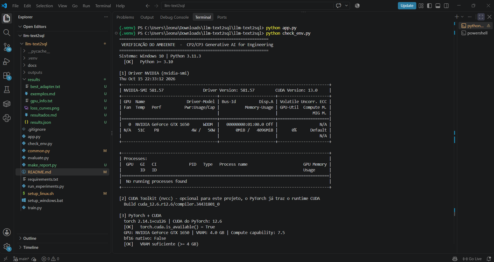
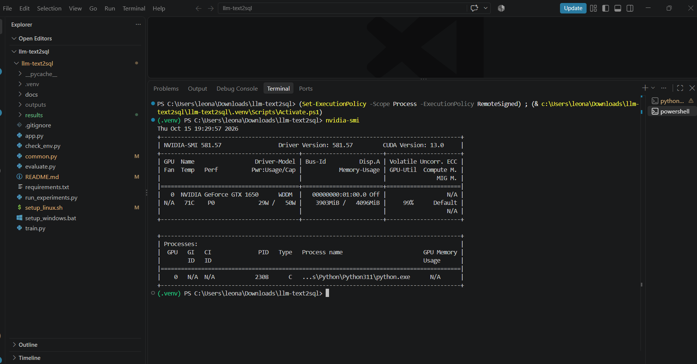
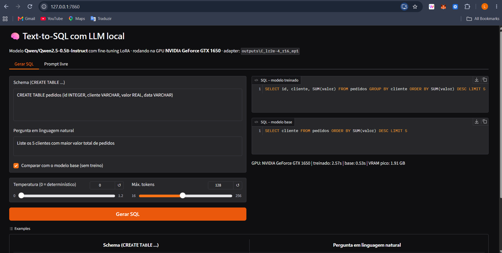

# 🧠 Text-to-SQL com LLM Local (Fine-tuning LoRA em GPU)

**CP2/CP3 – Generative AI for Engineering** · Prof. Francisco Elanio

| Integrante | RM |
|---|---|
| Nome 1 | RM00000 |
| Nome 2 | RM00000 |
| Nome 3 | RM00000 |
| Nome 4 | RM00000 |

---

## 1. Problema escolhido

**Converter perguntas em linguagem natural em consultas SQL (Text-to-SQL).**

Em engenharia de software, muita gente precisa consultar bancos de dados sem dominar SQL. O modelo recebe o
*schema* da tabela (`CREATE TABLE ...`) e uma pergunta, e devolve **apenas** a consulta SQL.

Escolhemos esse problema porque a resposta é **verificável objetivamente**: dá para comparar o SQL gerado com o
SQL correto e medir a taxa de acerto, antes e depois do treino.

```
Schema:   CREATE TABLE funcionarios (nome VARCHAR, salario INTEGER, departamento VARCHAR)
Pergunta: Qual o salário médio do departamento de Engenharia?
Saída:    SELECT AVG(salario) FROM funcionarios WHERE departamento = 'Engenharia'
```

## 2. LLM escolhida

**[Qwen2.5-0.5B-Instruct](https://huggingface.co/Qwen/Qwen2.5-0.5B-Instruct)** (Alibaba, licença Apache 2.0)

| Critério | Motivo |
|---|---|
| Tamanho (0,5 bilhão de parâmetros) | Treina em minutos e cabe em GPUs com 4 GB+ de VRAM |
| Versão *Instruct* | Já segue instruções no formato de chat |
| Bom em código | A família Qwen2.5 tem bom desempenho em programação, inclusive SQL |
| Roda 100% local | Sem API externa: modelo e dados ficam na máquina |

> Para usar outro modelo (ex.: `Qwen/Qwen2.5-1.5B-Instruct` em GPUs com 8 GB+), basta definir a variável de
> ambiente `MODEL_ID` antes de rodar os scripts.

## 3. Dataset

[`b-mc2/sql-create-context`](https://huggingface.co/datasets/b-mc2/sql-create-context): ~78 mil exemplos de
(pergunta, schema, SQL), derivados do WikiSQL e do Spider.

- **Treino:** 2.000 exemplos
- **Teste:** 100 exemplos separados, **nunca vistos no treino** (divisão fixa com `seed=42`)

## 4. Técnica: fine-tuning com LoRA

Em vez de treinar os 494 milhões de parâmetros, usamos **LoRA (Low-Rank Adaptation)**: congelamos o modelo
original e treinamos pequenas matrizes adicionais (cerca de 1–2% dos parâmetros) nas camadas de atenção e MLP.
Isso reduz muito o uso de memória e o tempo de treino, com resultado próximo ao fine-tuning completo.

- A *loss* é calculada **só sobre a resposta SQL**, não sobre o prompt (o modelo aprende a responder, não a repetir a pergunta).
- Precisão mista: **bf16** em GPUs RTX 30xx/40xx/50xx; **fp16** nas mais antigas (detecção automática).
- Tudo roda obrigatoriamente na **GPU**: os scripts abortam se CUDA não estiver disponível.

```
Dataset ──► Tokenização (chat template) ──► Qwen2.5-0.5B + LoRA ──► Treino na GPU
                                                                       │
            Frontend Gradio ◄── Melhor adapter ◄── Avaliação (Exact Match) ◄┘
```

## 5. Parâmetros testados

Cada experimento muda **um** parâmetro em relação ao experimento A (referência), para isolar o efeito:

| Experimento | Learning rate | LoRA rank (r) | Épocas | O que estamos testando |
|---|---|---|---|---|
| A | 2e-4 | 8 | 1 | Referência |
| B | **5e-5** | 8 | 1 | Learning rate menor aprende mais devagar? |
| C | 2e-4 | **16** | 1 | Mais capacidade no adapter ajuda? |
| D | 2e-4 | 8 | **2** | Mais épocas melhoram ou causam overfitting? |

Fixos: batch efetivo 16 (8 × 2 acumulações), scheduler cosine, warmup 5%, `lora_alpha = 2r`, dropout 0,05.

## 6. Avaliação

Cada modelo responde às **mesmas 100 perguntas de teste** e comparamos com o SQL correto:

- **Exact Match:** SQL idêntico ao esperado após normalização (maiúsculas/minúsculas, espaços, aspas, `;`).
- **Similaridade:** semelhança textual média (0–100%), que dá crédito parcial a respostas quase certas.

O **modelo base (sem treino)** também é avaliado, como linha de comparação.

## 7. Resultados

> Esta seção é preenchida automaticamente ao rodar `python run_experiments.py`.

<!-- RESULTS_START -->
*Ainda não executado: rode `python run_experiments.py`.*
<!-- RESULTS_END -->

### Análise

*(Preencher após rodar: qual configuração venceu e por quê. Exemplo do que observar: o modelo base costuma
explicar a resposta ou errar nomes de colunas; após o fine-tuning ele responde só com SQL no formato correto.
Learning rate muito baixo (B) tende a aprender menos em 1 época; mais épocas (D) reduzem a loss, mas é
preciso conferir se o acerto no teste também sobe.)*

## 8. GPU instalada e funcionando no VSCode





*Print do VSCode com a extensão GPU Monitor e o terminal executando `nvidia-smi` / `check_env.py` durante o treino.
A saída completa da verificação fica em [`results/gpu_info.txt`](results/gpu_info.txt).*

## 9. Frontend



Interface web em **Gradio** (`python app.py` → http://127.0.0.1:7860):

- **Aba "Gerar SQL":** o usuário digita o schema e a pergunta e vê o SQL do modelo treinado **lado a lado com o modelo base**, com o tempo de geração e a VRAM usada.
- **Aba "Prompt livre":** o usuário escreve qualquer prompt.
- Controles de **temperatura** e **máximo de tokens**.

---

## 10. Como rodar

### Pré-requisitos

| Item | Como verificar |
|---|---|
| GPU NVIDIA | `nvidia-smi` mostra o nome da placa |
| Driver NVIDIA atualizado | `nvidia-smi` mostra "CUDA Version" no canto superior direito |
| CUDA Toolkit | `nvcc --version` |
| Python 3.10 a 3.12 | `python --version` |
| Git | `git --version` |
| VSCode + extensões **GPU Environment** e **GPU Monitor** | Aba Extensions do VSCode |

**Qual CUDA usar:** veja o "CUDA Version" no `nvidia-smi` (é a versão **máxima** que seu driver suporta):

| `nvidia-smi` mostra | Use no PyTorch |
|---|---|
| 12.8 ou maior (obrigatório para RTX 50xx) | `cu128` |
| 12.6 – 12.7 | `cu126` |
| 12.4 – 12.5 | `cu124` |
| 11.8 – 12.3 | `cu118` |

### Passo a passo

```bash
# 1. Clonar
git clone https://github.com/SEU_USUARIO/llm-text2sql.git
cd llm-text2sql

# 2. Instalar (cria .venv, instala PyTorch com CUDA + dependências e verifica a GPU)
setup_windows.bat cu126          # Windows
./setup_linux.sh cu126           # Linux

# 3. Verificar a GPU (tirar print desta saída no VSCode)
python check_env.py

# 4. Teste rápido (~3 min) para confirmar que tudo funciona
python run_experiments.py --quick

# 5. Experimentos completos (~15-40 min, depende da GPU)
python run_experiments.py

# 6. Frontend
python app.py
```

Faltou memória (`CUDA out of memory`)? Use `python run_experiments.py --batch_size 4` (ou `2`).

### Comandos individuais

```bash
python train.py --lr 2e-4 --r 8 --epochs 1 --name meu_teste   # treina uma configuração
python evaluate.py                                            # avalia o modelo base
python evaluate.py --adapter outputs/meu_teste                # avalia um modelo treinado
```

## 11. Estrutura do repositório

```
├── common.py            # configuração, dataset, prompts, carregamento do modelo, métricas
├── train.py             # fine-tuning LoRA na GPU
├── evaluate.py          # avaliação (Exact Match e similaridade)
├── run_experiments.py   # pipeline completo: base + 4 experimentos + relatórios
├── app.py               # frontend Gradio
├── check_env.py         # verificação de GPU/CUDA/bibliotecas
├── setup_windows.bat / setup_linux.sh
├── requirements.txt
├── results/             # métricas, tabelas, gráfico de loss, exemplos, info da GPU
├── outputs/             # adapters LoRA treinados (fora do Git)
└── docs/                # prints
```

## 12. Limitações

- Modelo pequeno (0,5B): erra consultas complexas com JOINs entre várias tabelas.
- Exact Match é rígido: um SQL equivalente escrito de outra forma conta como erro (por isso também medimos similaridade).
- O dataset é em inglês; perguntas em português funcionam, mas com menos precisão.

## Referências

- Qwen2.5: https://huggingface.co/Qwen/Qwen2.5-0.5B-Instruct
- Dataset: https://huggingface.co/datasets/b-mc2/sql-create-context
- LoRA (Hu et al., 2021): https://arxiv.org/abs/2106.09685
- Hugging Face PEFT: https://github.com/huggingface/peft
